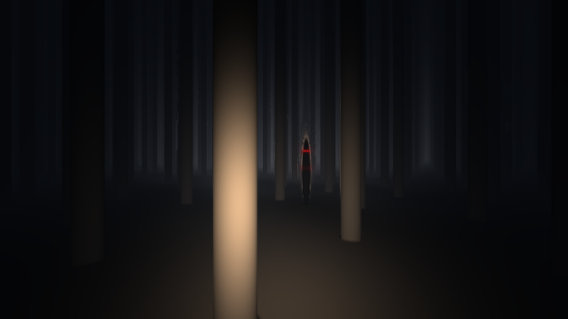

# Hollow

1 KB atmospheric horror. `index.html` is ≤ 1024 bytes.



Open it in a desktop browser with WebGL2 (Chrome, Edge, Firefox 113+, Safari 16.4+). It works from `file://` too.

You stand in a dead forest at night with a failing torch. Something tall with red eyes is out there. It only moves when you can't see it: when it's outside your beam, or when the torch cuts out. The torch fails more often the longer you last. If it reaches you, the round restarts.

**Controls:** move the mouse to look around.

## What's in the frame
- Sphere-traced SDF scene: endless jittered pine trunks, a ground plane, and the figure (a stretched ellipsoid).
- The torch is a swaying cone with linear falloff. Lighting is a one-tap directional derivative (`s(p - r*.1)`), so no normals are needed.
- The figure's SDF is scaled by 0.2, so the same lighting term leaves it near-black. Rays that graze it run out of steps, which gives it a dark, smoky aura.
- Red eyes are a glow integral (`Σ d/|p-eye|²`) gathered during the march. Trees and the body occlude them for free, and they show in total darkness. Mirroring with `abs(m)` makes 8 eyes, but 6 of them are hidden inside or behind the body.
- Drifting volumetric mist is lit only inside the beam. Depth fog fades to a moonlit blue-black.
- The torch flicker comes from `p*p % 9 > p/20`. It starts as rare blinks and becomes a strobe.
- Jumpscare: on contact, the figure snaps into your view and rushes into the camera.

## How it fits
| step | trick |
|---|---|
| WebGL2 | `gl_VertexID` builds a full-screen triangle, so no vertex buffer is needed |
| GLSL | zero-initialised globals, `mat2(cos(a+vec4(0,11,33,0)))` rotation, one `vec4` uniform with torch state in its sign |
| JS | `with(gl)`, `setInterval` clock, short-circuit game logic |
| pack | zopfli deflate-raw. The raw bytes go in a template literal on an ISO-8859-15 page (`<meta charset=l9>`). Only 8 bytes decode to other code points, and a 27-byte lookup maps them back. `DecompressionStream` inflates the payload and `eval` runs it. |
| tune | `search.js` tries random identifier letters (`names.json`) to minimise deflate size plus escaped bytes |

## Build
```bash
npm i @gfx/zopfli
```
```bash
node build.js
```
Sources are in `src/`. `min.js` is the unpacked payload.
