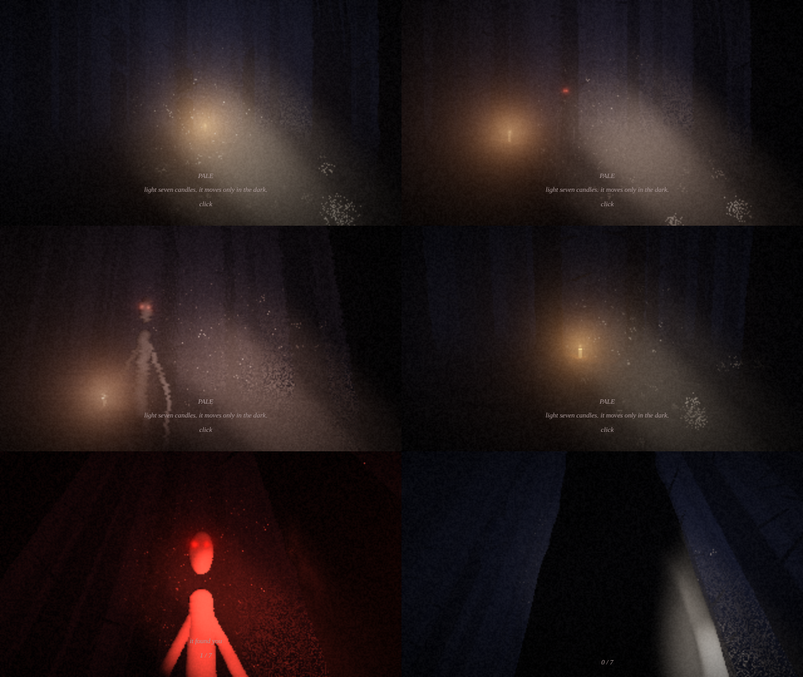

# PALE — 4 KB atmospheric horror



`index.html` = **4093 bytes**, self-contained, no network. Open it (file:// works) → click.

| | |
|---|---|
| Goal | light 7 candles (orange glow in the fog) → dawn |
| Threat | pale figure; moves **only when outside your torch beam**; holding it in the beam drains battery faster |
| Battery | drains always; flickers <30%; refilled by each candle |
| Controls | mouse look (click = pointer lock), WASD move |
| Fear cues | heartbeat rate, dissonant chord swell, VHS tear, red desaturation |

## Visual detail (single fragment shader, raymarched)
- infinite forest: jittered-grid trunks, 5-lobe root flare, bark noise, skeletal branches, clearings
- ground: value-noise relief + leaf-litter albedo, wet specular
- torch: offset from eye (visible beam), hotspot + spill cone, sway, inverse-square
- volumetric mist in beam (24 dithered samples, drifting noise density) + falling dust specks
- candle: point light on surroundings, flame flicker, core + fog halo
- figure: capsule skeleton always facing you; dark eye sockets with red pinpoints scaled for distance *and* close-up
- moonlit fog gradient, lightning (fog flash + delayed thunder)
- grade: Reinhard → gamma → S-curve crush, vignette, film grain, fear-driven tear/desat

## Audio (WebAudio, synthesized)
wind (noise → swept low-pass), footsteps, double-beat heartbeat, thunder, candle chime, dread cluster, death scream.

## Size tricks
1. GLSL whitespace strip; WebGL2 `gl_VertexID` fullscreen triangle (no buffers); one `uniform float u[16]` upload.
2. JS: implicit globals, `with(Math)`, `%1` as `fract`; JS collision reuses the shader's exact hash.
3. Candles/spawn on grid corners → always clear of trunks (no placement search).
4. **Roadroller** (context-mixing compressor) **patched**: rANS output in base 126 (bytes `0x01–0x7F` minus CR) instead of 6-bit chars, stored raw after a `<plaintext>` tag (no escaping, no end tag), read via `z.textContent` → ~14% smaller payload.

## Build
```
npm i          # installs roadroller + terser, writes patched copy to rr126/
npm run build  # src/ -> index.html, fails if > 4096 B
```
