# THERMAL

A first-person horror game told almost entirely through still images, set in rural Oregon in November 1997. You never move freely and there is no real-time camera. You move through frames: thermal trail-camera captures, disposable-camera flash photos and security-monitor grabs. Every frame is rendered procedurally in the browser at load time. There are no art or audio assets.

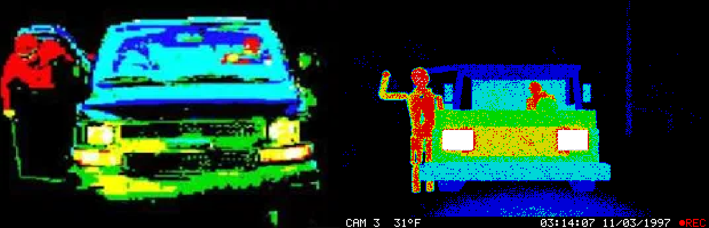

*Left: the reference image. Right: CAM 3, rendered by the still pipeline (milestone 1 acceptance test).*

## Run / build

```bash
npm install
npm run dev        # http://localhost:5173
npm run build      # -> dist/ (one classic script, runs offline, even from file://)
npm run preview    # serve dist/
npm run stills     # render every still to docs/stills/*.png (headless Playwright)
npm run manifest   # regenerate the still manifest + thumbnails below
npm run speedrun   # autopilot plays the game: minimum and realistic run times
node scripts/gen-stills.mjs   # regenerate src/data/stills.json from its source
```

URL flags: `?debug=1` (debug panel), `?res=256` (256×192), `?seed=N`, `?skipwarn=1`, `?timescale=N`, `?autopilot=min|human`.

## Controls

| Where | Input | Action |
|---|---|---|
| Everywhere | `Esc` / `P`, `H` | pause menu, controls |
| Frames (Act I, monitor) | `←/→`, click the frame edges | previous / next frame |
| | hold `Space` (touch: long-press) | blink comparator: flicker between this frame and the previous one |
| | `T`, then `↑/↓`, `[ ]` or drag the right-hand bar | thermal threshold tool: re-maps the raw heat buffer live and shows a °F readout |
| | mouse wheel, pinch, `+/-` | zoom: re-renders the region with more noise (detail never improves) |
| | click and drag | circle an anomaly and pin it to Walt's corkboard |
| | `B`, `C` | evidence board, index cards |
| Outside (Act II) | arrow keys, or click a direction label | choose a way |
| | hold `Enter` / `F` / mouse, then release | charge the flash, release to walk and shoot (costs 1 exposure) |
| | `Tab` | handheld thermal monitor at this spot (costs battery, not film) |
| | `E`, `M` | reset the trail camera here, Walt's map |
| The van (Act III) | `↑`, `F`, `Tab`, `Space`, `T` | walk closer, flash, monitor, blink, threshold |
| | click a figure, or `1` / `2` | choose |

The whole game can be played with the keyboard alone, the mouse alone, or touch alone.

## Design notes

**The pipeline** (`src/render/StillRenderer.js`) draws every still the same way:

1. **Scene.** Low-poly Three.js scenes built from primitives and procedural props (`src/props/`). Figures are capsule mannequins with poseable joints. No figure ever has a face.
2. **Heat pass.** Each object carries a scalar *temperature* (plus rim term, vertical gradient, fbm noise and atmospheric falloff) instead of a colour. It is rendered into a float target at 4× internal resolution. The same shader also does a *flash pass*: albedo times inverse-square falloff from a light at the lens. That pass is how a scene gets photographed with the disposable camera.
3. **Degradation.** Gaussian sensor bloom, radial heat bleed from hot sources (computed at 1/8 resolution), multiplicative grain at sensor resolution, vignette, and JPEG-ish 8×8 block DC and cosine noise.
4. **Box downsample** to 320×200 (or 256×192).
5. **Gradient map / posterize, live.** The raw heat buffer is kept. Every frame it is mapped through a LUT (6–8 hard bands, with non-uniform stops so bodies sit in a wide red band) using Bayer 4×4 combined with void-and-cluster blue-noise dithering. Hot bands smear 1 px for chromatic misregistration, and some frames get 8×8 attribute clash.
6. **OSD** in a custom 5×7 bitmap font (`src/render/font5x7.js`).

Because the heat buffer is stored, the threshold tool, palette cycling (hot bands breathe at about 3 Hz), dread-driven LUT drift and the blink comparator cost nothing per frame. Hidden figures exist only as heat values. For example, the figure inside the fir sits at about 0.31 heat inside 0.27 needles and only separates when you narrow the threshold window.

**Fidelity tricks.** Every frame keeps 35–50% pure black. Pareidolia bait appears throughout: a coat on a chair, a bush shaped like a crouching person, a mailbox. Consecutive stills change exactly one thing. Some frames have a micro-loop (a ±1 px breathing figure, a fluorescent flicker). Monitor frames get scan artifacts (tearing, a rolling bar, dropped lines). At high dread, a frame swaps 8×8 blocks toward its variant while you watch. Subliminal single-frame inserts appear, and the reduce-flashes option disables them.

**Caching.** The first launch "develops film". That renders Act I, the title and the inserts, then keeps rendering the rest in the background while you play. Heat buffers are quantised to Uint16 and stored in IndexedDB, so a reload is instant. Thumbnails are ImageBitmaps.

**The rules it obeys** (learned from Walt's cards):
- It only shows up warm.
- It never appears in the flash.
- It copies how you stand.
- It only moves between pictures you have seen. In Act II it advances along the node graph only when you take a photo, and charging the flash longer gives it more time.
- Over the game its temperature drifts from red toward white.

**Dread** (`src/game/dread.js`) is a hidden value. It rises while you look at frames containing it, when you re-view frames, while you hesitate, and when it is near. Dread drives the drone depth, subliminal insert rate, LUT drift and morphing frames.

**Failure is soft.** If it is waiting in the dark where you shoot, the camera winds on by itself (−2 film) and the monitor loses battery. Everything funnels into three endings: **Cold**, **Warm** and **Exposure** (out of film). There are exactly two earned jump-scares, at the end of Act I and at the Act III choice. Each one is preceded by 1.2 s of absolute silence.

**Audio** (`src/audio/engine.js`) is all Web Audio synthesis:
- Beds: wind, distant highway, crickets that stop when it is near, 60 Hz hum, tape hiss.
- Foley: trail-cam click, film wind, shutter, flash-charge whine (2 to 8 kHz), gravel and leaf footsteps, door creak.
- A dread layer: a 35–45 Hz drone with detuned beating sines.
- An echo step that plays one step behind you.

**Accessibility:**
- A photosensitivity warning at boot.
- Reduce flashes: a white flash becomes a 200 ms fade, subliminal inserts are off and tearing is capped.
- Subtitles for meaningful sounds.
- Band patterns for colour-blind players (each threshold band gets its own texture).
- Hard mode removes hover hints.
- Volume and mute.

**Pacing.** The 1997 card reader takes 5.5 s to pull each file off the card. The flash needs 1.5 s to recycle. Each walk between places takes 5.5 s and the afterimage burns for 1.5 s. The shortest route through Act II is 12 moves, and all three cameras must be reset. `npm run speedrun` measures this: see `docs/speedrun.json`.

## Architecture

```
src/main.js                  boot + state machine (Title -> Intro -> Act1 -> Act2 -> Act3 -> Ending)
src/render/                  StillRenderer (heat pass, degradation), lut, dither, compositor, osd, font5x7, cards, stills (bank)
src/scenes/                  one module per location: build(rng, variant, params) -> scene + camera (+ tagged hotspots)
src/props/                   van, pickup, sedan, figure rig, firs, deer, carcass, trailer, shed, poles, fence, canopy, ...
src/game/                    game shell, viewer, dread, save, clock, ui, acts/ (front, act1, act2, act3, endings, controls)
src/audio/engine.js          procedural beds, foley, dread layer
src/data/stills.json         ordered still manifest (generated by scripts/gen-stills.mjs)
src/data/nodes.js            Act II node graph
src/debug/                   ?debug=1 panel, autopilot, still dump pages
```

## Still manifest

<!-- STILLS:BEGIN -->
149 stills (6 change-variants, 4 subliminal inserts). Full-size renders in `docs/stills/`.

| | id | act | scene/variant | pass | camera | LUT | timestamp |
|---|---|---|---|---|---|---|---|
| 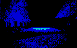 | `i_road` | Title / intro | road/ahead | heat | none | thermal |  |
| 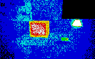 | `i_desk` | Title / intro | desk/intro | heat | none | thermal |  |
| 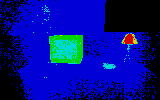 | `i_dark` | Act I | desk/dark | heat | none | thermal |  |
| 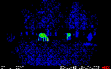 | `a1_01` | Act I | meadow/deer | heat | CAM 1 | thermal | 02:11:40 10/19/1997 |
| 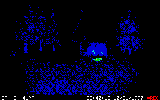 | `a1_02` | Act I | drive/raccoon | heat | CAM 3 | thermal | 23:40:12 10/21/1997 |
| 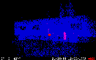 | `a1_03` | Act I | trailer/raccoon | heat | CAM 2 | iron | 01:05:55 10/22/1997 |
| 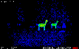 | `a1_04` | Act I | meadow/bolt1 | heat | CAM 1 | thermal | 03:30:01 10/24/1997 |
| 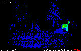 | `a1_05` | Act I | meadow/bolt2 | heat | CAM 1 | thermal | 03:30:02 10/24/1997 |
| 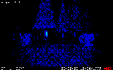 | `a1_06` | Act I | meadow/bolt3 | heat | CAM 1 | thermal | 03:30:03 10/24/1997 |
| 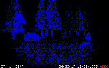 | `a1_07` | Act I | meadow/hidden | heat | CAM 1 | thermal | 04:02:19 10/25/1997 |
| 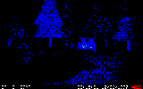 | `a1_08` | Act I | drive/empty | heat | CAM 3 | thermal | 22:15:31 10/26/1997 |
| 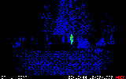 | `a1_09` | Act I | meadow/figure | heat | CAM 1 | thermal | 03:12:44 10/27/1997 |
| 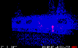 | `a1_10` | Act I | trailer/coat | heat | CAM 2 | iron | 02:47:09 10/28/1997 |
| 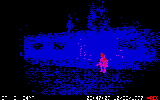 | `a1_11` | Act I | trailer/edit | heat | CAM 2 | iron | 02:47:09 10/28/1997 |
| 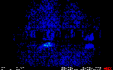 | `a1_12` | Act I | meadow/carcass | heat | CAM 1 | thermal | 05:20:11 10/30/1997 |
| 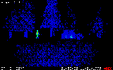 | `a1_13` | Act I | drive/walk1 | heat | CAM 3 | thermal | 01:58:30 11/01/1997 |
| 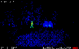 | `a1_14` | Act I | drive/walk2 | heat | CAM 3 | thermal | 01:58:31 11/01/1997 |
| 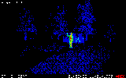 | `a1_15` | Act I | drive/walk3 | heat | CAM 3 | thermal | 01:58:32 11/01/1997 |
| 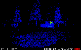 | `a1_16` | Act I | drive/sleep | heat | CAM 3 | thermal | 04:40:05 11/01/1997 |
| 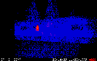 | `a1_17` | Act I | trailer/window | heat | CAM 2 | iron | 03:14:07 11/02/1997 |
| 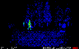 | `a1_18` | Act I | meadow/walt | heat | CAM 1 | thermal | 02:58:10 11/03/1997 |
| 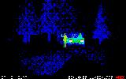 | `a1_19` | Act I | drive/two | heat | CAM 3 | thermal | 03:14:07 11/03/1997 |
| 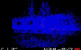 | `a1_20` | Act I | trailer/door | heat | CAM 2 | iron | 06:30:44 11/05/1997 |
| 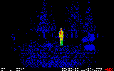 | `a1_21` | Act I | meadow/open | heat | CAM 1 | thermal | 02:02:02 11/09/1997 |
| 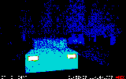 | `a1_22` | Act I | drive/arrive | heat | CAM 3 | thermal | 21:50:37 11/14/1997 |
| 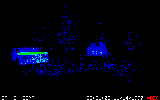 | `a1_23` | Act I | drive/parked | heat | CAM 3 | thermal | 22:31:08 11/14/1997 |
| 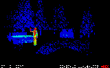 | `a1_24` | Act I | drive/tonight | heat | CAM 3 | thermal | now+6 11/14/1997 |
| 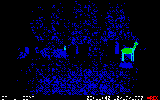 | `a1_01b` | Act I | meadow/bolt2 | heat | CAM 1 | thermal | 02:11:40 10/19/1997 |
| 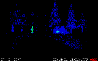 | `a1_08b` | Act I | drive/walk1 | heat | CAM 3 | thermal | 22:15:31 10/26/1997 |
| 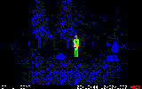 | `a1_09b` | Act I | meadow/open | heat | CAM 1 | thermal | 03:12:44 10/27/1997 |
| 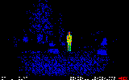 | `a1_12b` | Act I | meadow/open | heat | CAM 1 | thermal | 05:20:11 10/30/1997 |
| 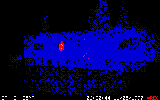 | `a1_20b` | Act I | trailer/window | heat | CAM 2 | iron | 06:30:44 11/05/1997 |
| 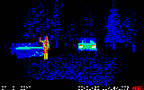 | `a1_23b` | Act I | drive/tonight2 | heat | CAM 3 | thermal | 22:31:08 11/14/1997 |
| 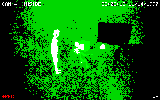 | `a1_live` | Act I | desk/live | heat | CAM 4 (INSIDE) | night | now 11/14/1997 |
| 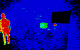 | `a1_scare` | Act I | desk/behind | heat | none | thermal |  |
| 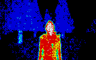 | `a1_face` | Act I | close/face | heat | none | thermal |  |
|  | `card_warm` | Act I | card/- | card | none | scan |  |
|  | `card_flash` | Act I | card/- | card | none | scan |  |
| 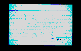 | `card_van` | Act I | card/faded | card | none | scan |  |
| 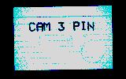 | `card_pin` | Act I | card/pin | card | none | scan |  |
|  | `card_copy` | Act I | card/- | card | none | scan |  |
| 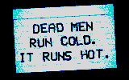 | `card_cold` | Act I | card/- | card | none | scan |  |
| 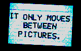 | `card_moves` | Act I | card/- | card | none | scan |  |
| 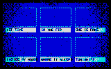 | `board` | Act I | card/board | card | none | scan |  |
| 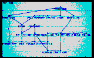 | `map` | Act II | card/map | card | none | scan |  |
| 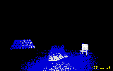 | `n_steps_f` | Act II | forest/default | flash | flash | flash |  |
| 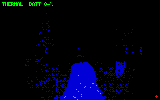 | `n_steps_t` | Act II | forest/default | heat | handheld | thermal |  |
| 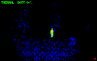 | `n_steps_i` | Act II | forest/it | heat | handheld | thermal |  |
| 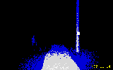 | `n_yard_f` | Act II | forest/default | flash | flash | flash |  |
| 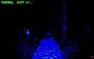 | `n_yard_t` | Act II | forest/default | heat | handheld | thermal |  |
| 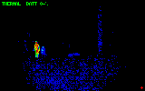 | `n_yard_i` | Act II | forest/it | heat | handheld | thermal |  |
| 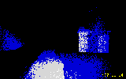 | `n_shed_f` | Act II | forest/default | flash | flash | flash |  |
|  | `n_shed_t` | Act II | forest/default | heat | handheld | thermal |  |
|  | `n_shed_i` | Act II | forest/it | heat | handheld | thermal |  |
|  | `n_woodpile_f` | Act II | forest/default | flash | flash | flash |  |
|  | `n_woodpile_t` | Act II | forest/default | heat | handheld | thermal |  |
|  | `n_woodpile_i` | Act II | forest/it | heat | handheld | thermal |  |
|  | `n_outhouse_f` | Act II | forest/default | flash | flash | flash |  |
|  | `n_outhouse_t` | Act II | forest/default | heat | handheld | thermal |  |
|  | `n_outhouse_i` | Act II | forest/it | heat | handheld | thermal |  |
|  | `n_trailhead_f` | Act II | forest/default | flash | flash | flash |  |
|  | `n_trailhead_t` | Act II | forest/default | heat | handheld | thermal |  |
|  | `n_trailhead_i` | Act II | forest/it | heat | handheld | thermal |  |
|  | `n_firs_f` | Act II | forest/default | flash | flash | flash |  |
|  | `n_firs_t` | Act II | forest/default | heat | handheld | thermal |  |
|  | `n_firs_i` | Act II | forest/it | heat | handheld | thermal |  |
|  | `n_ridge_f` | Act II | forest/default | flash | flash | flash |  |
|  | `n_ridge_t` | Act II | forest/default | heat | handheld | thermal |  |
|  | `n_ridge_i` | Act II | forest/it | heat | handheld | thermal |  |
|  | `n_meadow_f` | Act II | forest/default | flash | flash | flash |  |
|  | `n_meadow_t` | Act II | forest/default | heat | handheld | thermal |  |
|  | `n_meadow_i` | Act II | forest/it | heat | handheld | thermal |  |
|  | `n_carcass_f` | Act II | forest/default | flash | flash | flash |  |
|  | `n_carcass_t` | Act II | forest/default | heat | handheld | thermal |  |
|  | `n_carcass_i` | Act II | forest/it | heat | handheld | thermal |  |
|  | `n_creek_f` | Act II | forest/default | flash | flash | flash |  |
|  | `n_creek_t` | Act II | forest/default | heat | handheld | thermal |  |
|  | `n_creek_i` | Act II | forest/it | heat | handheld | thermal |  |
|  | `n_footbridge_f` | Act II | forest/default | flash | flash | flash |  |
|  | `n_footbridge_t` | Act II | forest/default | heat | handheld | thermal |  |
|  | `n_footbridge_i` | Act II | forest/it | heat | handheld | thermal |  |
|  | `n_powerline_f` | Act II | forest/default | flash | flash | flash |  |
|  | `n_powerline_t` | Act II | forest/default | heat | handheld | thermal |  |
|  | `n_powerline_i` | Act II | forest/it | heat | handheld | thermal |  |
|  | `n_dump_f` | Act II | forest/default | flash | flash | flash |  |
|  | `n_dump_t` | Act II | forest/default | heat | handheld | thermal |  |
|  | `n_dump_i` | Act II | forest/it | heat | handheld | thermal |  |
|  | `n_fence_f` | Act II | forest/default | flash | flash | flash |  |
|  | `n_fence_t` | Act II | forest/default | heat | handheld | thermal |  |
|  | `n_fence_i` | Act II | forest/it | heat | handheld | thermal |  |
|  | `n_road_f` | Act II | road/default | flash | flash | flash |  |
|  | `n_road_t` | Act II | road/default | heat | handheld | thermal |  |
|  | `n_road_i` | Act II | road/it | heat | handheld | thermal |  |
|  | `n_blind_f` | Act II | forest/default | flash | flash | flash |  |
|  | `n_blind_t` | Act II | forest/default | heat | handheld | thermal |  |
|  | `n_blind_i` | Act II | forest/it | heat | handheld | thermal |  |
|  | `n_gate_f` | Act II | forest/default | flash | flash | flash |  |
|  | `n_gate_t` | Act II | forest/default | heat | handheld | thermal |  |
|  | `n_gate_i` | Act II | forest/it | heat | handheld | thermal |  |
|  | `n_drive_f` | Act II | van/cold | flash | flash | flash |  |
|  | `n_drive_t` | Act II | van/cold | heat | handheld | thermal |  |
|  | `n_drive_i` | Act II | van/cold | heat | handheld | thermal |  |
|  | `cam1_b1` | Act II | meadow/dana1 | heat | CAM 1 | thermal | now-3s 11/14/1997 |
|  | `cam1_b2` | Act II | meadow/dana2 | heat | CAM 1 | thermal | now-2s 11/14/1997 |
|  | `cam1_b3` | Act II | meadow/dana3 | heat | CAM 1 | thermal | now-1s 11/14/1997 |
|  | `cam2_b1` | Act II | trailer/dana1 | heat | CAM 2 | iron | now-3s 11/14/1997 |
|  | `cam2_b2` | Act II | trailer/dana2 | heat | CAM 2 | iron | now-2s 11/14/1997 |
|  | `cam2_b3` | Act II | trailer/dana3 | heat | CAM 2 | iron | now-1s 11/14/1997 |
|  | `cam3_b1` | Act II | drive/reset1 | heat | CAM 3 | thermal | now-3s 11/14/1997 |
|  | `cam3_b2` | Act II | drive/reset2 | heat | CAM 3 | thermal | now-2s 11/14/1997 |
|  | `cam3_b3` | Act II | drive/reset3 | heat | CAM 3 | thermal | now-1s 11/14/1997 |
|  | `a3_approach_A` | Act III | van/far | heat | handheld | thermal |  |
|  | `a3_far_f_A` | Act III | van/far | flash | flash | flash |  |
|  | `a3_far_t_A` | Act III | van/far | heat | handheld | thermal |  |
|  | `a3_mid_f_A` | Act III | van/mid | flash | flash | flash |  |
|  | `a3_mid_t_A` | Act III | van/mid | heat | handheld | thermal |  |
|  | `a3_ref_A` | Act III | van/ref | heat | handheld | thermal |  |
|  | `a3_raise_A` | Act III | van/ref | heat | handheld | thermal |  |
|  | `a3_ref_f_A` | Act III | van/ref | flash | flash | flash |  |
|  | `a3_cam_A` | Act III | drive/mirror | heat | CAM 3 | thermal | now 11/14/1997 |
|  | `a3_approach_B` | Act III | van/far | heat | handheld | thermal |  |
|  | `a3_far_f_B` | Act III | van/far | flash | flash | flash |  |
|  | `a3_far_t_B` | Act III | van/far | heat | handheld | thermal |  |
|  | `a3_mid_f_B` | Act III | van/mid | flash | flash | flash |  |
|  | `a3_mid_t_B` | Act III | van/mid | heat | handheld | thermal |  |
|  | `a3_ref_B` | Act III | van/ref | heat | handheld | thermal |  |
|  | `a3_raise_B` | Act III | van/ref | heat | handheld | thermal |  |
|  | `a3_ref_f_B` | Act III | van/ref | flash | flash | flash |  |
|  | `a3_cam_B` | Act III | drive/mirror | heat | CAM 3 | thermal | now 11/14/1997 |
|  | `e_c1` | Endings | road/back | heat | none | thermal |  |
|  | `e_c2` | Endings | road/ahead | heat | none | thermal |  |
|  | `e_c3` | Endings | road/canopy | heat | none | thermal |  |
|  | `e_c4` | Endings | road/ahead | heat | none | thermal |  |
|  | `e_c5` | Endings | mirror/blob | heat | none | thermal |  |
|  | `e_w1_A` | Endings | close/door | heat | none | thermal |  |
|  | `e_w7_A` | Endings | van/dana | heat | CAM 3 | thermal | now 11/14/1997 |
|  | `e_w1_B` | Endings | close/door | heat | none | thermal |  |
|  | `e_w7_B` | Endings | van/dana | heat | CAM 3 | thermal | now 11/14/1997 |
|  | `e_w2` | Endings | close/hand | heat | none | thermal |  |
|  | `e_w3` | Endings | close/wake | heat | none | thermal |  |
|  | `e_w4` | Endings | close/face | heat | none | thermal |  |
|  | `e_w5` | Endings | close/seat | heat | none | thermal |  |
|  | `e_w6` | Endings | van/ref | heat | none | thermal |  |
|  | `e_x2` | Endings | meadow/dawn | heat | CAM 1 | thermal | 06:12:40 11/15/1997 |
|  | `sub_behind` | Subliminal | close/behind | heat | none | thermal |  |
|  | `sub_hand` | Subliminal | close/hand | heat | none | thermal |  |
|  | `sub_seat` | Subliminal | close/seat | heat | none | thermal |  |
|  | `sub_face` | Subliminal | close/face | heat | none | thermal |  |
|  | `title` | Title / intro | van/ref | heat | CAM 3 | thermal | 03:14:07 11/03/1997 |
<!-- STILLS:END -->
